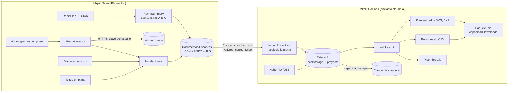

# Auditoría integral — Mkpkr Cocinas y Mkpkr Scan

Fecha: 9 de noviembre de 2026 · Commit auditado: `73772c3` (rama `claude/poker-ai-analyzer-ft3hbe`)
Alcance: las dos aplicaciones del repositorio, su integración, el sistema de compilación y publicación, y el producto como negocio.
Durante la auditoría no se ha modificado código, datos ni configuración. Todas las pruebas se han hecho sobre una copia cargada en un navegador de pruebas.

**Cómo leer las etiquetas de evidencia**

| Etiqueta | Significado |
|---|---|
| **[V]** | Verificado con una prueba ejecutada en esta auditoría (reproducible; ver anexo A). |
| **[C]** | Verificado leyendo el código, sin ejecutarlo. |
| **[R]** | Riesgo o hipótesis razonada; no comprobado. |
| **[NV]** | No verificable en este entorno (hace falta un iPhone con LiDAR, una clave de API o un programa externo). |

---

## 1. Resumen ejecutivo

**Qué es el proyecto.** Dos aplicaciones para que una tienda de cocinas o un reformista pase de la visita a casa del cliente a un plano, un diseño, un presupuesto y un render:

- **Mkpkr Scan** (iPhone/iPad Pro, Swift): escanea la cocina con LiDAR (RoomPlan de Apple), detecta instalaciones (agua, desagüe, enchufes, humos, gas), toma medidas sueltas y exporta el escaneo.
- **Mkpkr Cocinas** (web, un único archivo HTML publicado como artefacto de claude.ai): importa el escaneo, distribuye los muebles automáticamente, genera planta y alzados acotados, presupuesto, memoria y vista 3D.

**Valoración general.** La idea es buena y el recorrido completo existe de punta a punta, lo cual es poco habitual en un prototipo de pocos días. Pero hoy es un **prototipo de demostración, no un producto**. Madurez estimada: web 5/10, app iOS 3/10, integración 3/10, operación y calidad 2/10.

**Las cinco conclusiones que importan**

1. **El núcleo falla en silencio en casos reales.** La importación de escaneos da una planta errónea, con mensaje de éxito, en cocinas abiertas, en U, en L estrecha o con un tabique suelto (4 de 9 geometrías de prueba) **[V]**. En un producto de medición, un dato erróneo presentado como bueno es el peor fallo posible.
2. **La distribución automática no es fiable.** En 600 cocinas aleatorias, el 23 % tiene un mueble que invade físicamente el hueco de una puerta de otra pared y el 17 % se queda sin placa o sin fregadero habiendo sitio. Las comprobaciones de la app no lo tratan como problema: la falta de placa aparece como «nota» y, de 136 puertas invadidas, solo 25 coinciden con algún aviso de «Problema» **[V]**. La propia cocina de ejemplo tapa 10–20 cm de su puerta **[V]**.
3. **Se pierden datos con facilidad.** Solo existe un proyecto a la vez; importar un escaneo sobrescribe estancia, huecos, tomas y módulos sin preguntar ni poder deshacer; y si el usuario ha convertido el ejemplo en su proyecto, además borra nombre, notas y memoria **[V]**.
4. **Casi nada de la app iOS está validado en dispositivo.** Compila (5 de 5 compilaciones en verde **[V]**) y el propietario ha hecho al menos un escaneo, pero la detección de instalaciones, el marcado con cruz, la llamada a Claude y la precisión real no se han probado nunca **[NV]**.
5. **La arquitectura actual no permite venderlo.** La web depende del entorno de claude.ai (sin él no hay descargas ni IA **[V]**), no hay cuentas, ni servidor, ni sincronización, y el traspaso app → web es manual por archivo. Sirve para uso propio; no para clientes.

**Qué haría.** Seis semanas de estabilización y validación en campo antes de añadir nada nuevo; después, completar el flujo comercial (PDF de presupuesto, varios proyectos, corrección con láser, traspaso directo) y solo entonces decidir, con datos de 10–20 cocinas reales, si se convierte en SaaS.

---

## 2. Mapa de arquitectura

### 2.1 Inventario **[V]**

| Elemento | Ubicación | Tamaño | Tecnología |
|---|---|---|---|
| Mkpkr Cocinas | `cocinas.html` | 1.400 líneas, 124 KB, 13 líneas de más de 400 caracteres (máx. 822) | HTML + CSS + JavaScript sin compilar, sin módulos ni tipos |
| Mkpkr Scan | `ios/MkpkrScan/MkpkrScan/*.swift` | 10 archivos, 1.936 líneas | SwiftUI, RoomPlan, ARKit, RealityKit, QuickLook; iOS 16+ |
| Proyecto Xcode | `ios/MkpkrScan/project.yml` | 35 líneas | XcodeGen (el `.xcodeproj` no se versiona) |
| Compilación y publicación | `.github/workflows/ios.yml` | 53 líneas | GitHub Actions, macOS 15, Xcode 16.4 |
| Documentación | `README.md`, `ios/MkpkrScan/README.md` | 53 líneas | — |
| Pruebas automáticas | — | **0** | No existe ninguna en el repositorio |

Dependencias externas de la web: three.js r128 (603 KB), OrbitControls desde jsDelivr, JSZip 3.10.1 (98 KB) y tres familias de Google Fonts. No hay servidor, base de datos, autenticación, variables de entorno ni monitorización.

### 2.2 Diagrama

### 2.3 Flujo principal reconstruido

1. **Visita** (app): escanear → guardar → instalaciones (automáticas, con cruz o a mano) → medidas sueltas.
2. **Traspaso** (manual): «Enviar a Mkpkr Cocinas» → elegir canal → descargar en el ordenador → abrir la web → «Abrir proyecto o escaneo». Cinco pasos y dos dispositivos.
3. **Oficina** (web): revisar estancia → distribución automática → ajustar módulos → planos → presupuesto → memoria → render → paquete .zip.

### 2.4 Estado de madurez por bloque

| Bloque | Estado | Comentario |
|---|---|---|
| Lectura de nubes de puntos (PLY/OBJ/XYZ) | Terminado, probado en sintético | Exacto y rápido con datos limpios **[V]**; sin probar con escaneos reales con muebles **[NV]** |
| Importación de RoomPlan | **Incompleto** | Solo fiable en estancias cerradas y sencillas **[V]** |
| Editor de estancia | Provisional | Sin validaciones; no se puede corregir una pared escaneada |
| Distribución automática | **Provisional** | Heurística voraz sin restricciones globales |
| Editor de módulos | Incompleto | Tabla numérica; se puede quitar pero no añadir |
| Planta, alzados, SVG, DXF, CSV | Terminado | Archivos válidos **[V]**; DXF básico |
| Presupuesto | Incompleto | Sin datos de cliente, PDF, líneas libres ni céntimos; enseña el margen |
| Memoria con Claude | Terminado (camino feliz) | Solo dentro de claude.ai |
| Visor 3D | Terminado | Imagen exportada de baja resolución |
| Escaneo y ficha (iOS) | Terminado, uso real mínimo | Un escaneo del propietario |
| Detección de instalaciones (iOS) | **Sin probar** | Nunca ejecutada en dispositivo ni contra la API |
| Cinta métrica AR (iOS) | Sin probar | — |
| Compilación y entrega del .ipa | Funciona | Con problemas de trazabilidad (E-18) |

### 2.5 ¿Están bien separadas las dos aplicaciones?

Separadas sí; **coordinadas no**. Cada una recalcula por su cuenta la planta a partir del JSON bruto de RoomPlan (`RoomSummary.swift` en Swift e `importRoomPlan`, `cocinas.html:1133`, en JavaScript). Las letras de las paredes coinciden solo porque ambos algoritmos se escribieron iguales; no hay contrato ni prueba que lo garantice **[C]**. Deberían compartir un **formato de intercambio explícito** (planta ya resuelta, huecos e instalaciones por pared), no lógica duplicada (ver §5).

---

## 3. Auditoría de la aplicación 1 — Mkpkr Cocinas (web)

### 3.1 Lo que funciona bien **[V]**

- Sin errores de consola en el recorrido completo de las seis pestañas, en claro y oscuro, a 390, 768 y 1.300 px; la página nunca desborda en horizontal.
- Persistencia y redondo «exportar proyecto → abrir» idénticos byte a byte.
- Presupuesto aritméticamente coherente (suma de líneas = subtotal; margen e IVA correctos).
- DXF válido (leído con `ezdxf`: 0 errores, 81 líneas y 15 textos, 7 capas, extensión 4.040 × 3.140 mm para una estancia de 3.800 × 2.900 con muros de 120). SVG bien formados y sin dependencias de estilos. CSV con separador y decimales españoles.
- Nubes de puntos: 300.000 puntos en 0,65–0,88 s; un PLY de 24 MB y 2 millones de puntos en 0,87 s; planta recuperada 420 × 310 cm exactos en binario, ASCII, eje Z y milímetros.
- Medición sobre foto: 199,3 cm medidos frente a 200,0 esperados (0,35 %).
- Rendimiento de cálculo irrelevante como problema: distribución 0,23 ms, planta 0,56 ms, reconstrucción 3D 3,3 ms.
- El contenido que devuelve Claude se escapa correctamente antes de pintarlo.

### 3.2 Problemas principales

Los detalles (ubicación, evidencia, solución, esfuerzo y prueba) están en el registro de errores (§6). En resumen:

- **Importación que falla en silencio** (E-01) y **sin validar** ni versionar los archivos de proyecto (E-04, E-05).
- **Distribución automática poco fiable** (E-02) y sus comprobaciones demasiado permisivas.
- **Pérdida de datos**: un solo proyecto, importaciones destructivas sin confirmar, sin deshacer (E-03).
- **Presupuesto no presentable a un cliente** (E-11, E-12): enseña el margen, redondea a euros, no tiene PDF ni datos de cliente.
- **Dependencia del entorno de claude.ai** (E-25): fuera de él no se puede descargar nada.
- **Accesibilidad y móvil** deficientes (E-20, E-21).

### 3.3 Calidad del código

| Aspecto | Hallazgo | Evidencia |
|---|---|---|
| Estructura | Un archivo con marcado, estilos y unas 970 líneas de lógica; funciones de 60–100 líneas con líneas de hasta 822 caracteres | **[V]** recuento |
| Estado | Objeto global `S` mutado desde unos 60 manejadores de eventos; cada cambio repinta la vista entera con `innerHTML` (21 usos) | **[C]** |
| Tipado y validación | Ninguno. Los datos de archivo entran sin comprobar (`S=s`, `cocinas.html:974`) | **[V]** E-04, E-05 |
| Duplicación | Cálculo de tramos de encimera repetido en planta, alzado y 3D; geometría de la estancia duplicada en Swift | **[C]** |
| Código muerto | Campo `measures` del proyecto nunca se usa (`cocinas.html:505`) | **[V]** |
| Pruebas | Ninguna en el repositorio; las de esta auditoría son externas | **[V]** |
| Gestión de errores | Sin manejador global; los fallos dejan la vista a medias sin mensaje | **[V]** E-05, E-09 |
| Dependencias | three.js r128 es de 2021 y OrbitControls se carga de una ruta retirada en versiones posteriores | **[C]**, riesgo bajo |

No recomiendo reescribir. La lógica (geometría, distribución, presupuesto, exportadores) es JavaScript puro y portable. Lo que hace falta es **partirla en módulos con tipos y pruebas** y generar el archivo único como resultado de compilación (ver §5.3).

### 3.4 Oportunidades

Las principales: editor directo sobre la planta, corrección de paredes con láser, lista de proyectos, PDF de presupuesto con marca, tarifas propias importables y un motor de distribución con restricciones que ofrezca varias alternativas (§8).

---

## 4. Auditoría de la aplicación 2 — Mkpkr Scan (iOS)

### 4.1 Lo que se puede afirmar

- **Compila** sin errores con Xcode 16.4 en las cinco ejecuciones de GitHub Actions **[V]**.
- El propietario la instaló con Sideloadly, hizo un escaneo y exportó `simancas.json` (190 KB) con la primera versión **[V, por capturas del propietario]**.
- La matemática que sitúa una instalación en la pared (rayo de cámara + intersección + localización) es correcta bajo la convención de cámara documentada por Apple: réplica independiente con 13.875 tomas simuladas, 13.875 recuperadas a menos de 5 mm **[V]**.

### 4.2 Lo que no se puede afirmar **[NV]**

- Que el JSON real de RoomPlan se importe bien en la web (la única prueba real falló por usar el botón equivocado; el arreglo no se ha confirmado).
- Que la detección automática funcione: la petición a la API de Claude no se ha ejecutado nunca, ni la proyección con poses reales.
- Que Claude localice bien instalaciones en fotos que recibe giradas 90° (la app envía la imagen del sensor en horizontal aunque el móvil esté en vertical) **[C]**.
- La precisión real de paredes, cruz y cinta métrica.
- El comportamiento sin permiso de cámara, con el escaneo interrumpido o con sesiones largas.

### 4.3 Problemas principales (detalle en §6)

- **E-06** La detección marca el escaneo como «analizado» y borra las instalaciones detectadas aunque la clave sea inválida; además se lanza sola, con coste, al abrir un escaneo **[C]**.
- **E-07** No hay gestión de errores de la sesión de escaneo ni del permiso de cámara **[C]**.
- **E-08** Las 45 fotos se llenan por orden de llegada: en una cocina grande las últimas paredes se quedan sin fotos y, por tanto, sin detección **[C]**.
- **E-01** La app comparte el algoritmo de planta que falla en estancias abiertas o en U **[C]**; las letras de pared, el área y la posición de las tomas saldrían mal.
- **E-27** El coste por escaneo que se comunicó («unos céntimos») está infravalorado: la estimación es de 0,30–0,60 USD **[R]**.
- **E-31** Fotos del domicilio del cliente guardadas sin cifrar, visibles en Archivos, incluidas en copias de seguridad y enviadas a un tercero sin texto de consentimiento **[C]**.
- **E-30** Sensibilidad de la detección: un error de 25 px de Claude al señalar (sobre 1.024 px) desplaza la toma 7,8 cm de mediana; 50 px, 15,7 cm **[V]**.
- Sin icono, sin número de versión visible (siempre 0.1.0 (1)), sin pruebas, sin localización, sin manifiesto de privacidad **[C]**.

### 4.4 Calidad del código

Código compacto y legible, con una separación razonable (captura, almacén, resumen, detección, vistas). Deuda concreta:

- `ScanDetailView.swift` (412 líneas) mezcla presentación, edición, exportación y lanzamiento de la detección.
- `ScanStore` escribe en disco en el hilo principal y silencia errores con `try?` (un fallo al guardar fotos o el USDZ pasa inadvertido) **[C]**.
- La salida de compilación se recorta a 60 líneas en CI, así que los avisos del compilador no se ven **[V]**.
- La clave de API vive en el dispositivo y la app llama a la API directamente: válido para uso propio, inviable para distribuir (cada usuario necesitaría su clave y no hay control de gasto).

### 4.5 Oportunidades

Usar el polígono de suelo que RoomPlan ofrece desde iOS 17 en lugar de reconstruirlo **[R, verificar en dispositivo]**; corrección de paredes con láser; enviar las fotos a la web; ver el diseño terminado en realidad aumentada sobre la cocina real, aprovechando que escaneo y diseño comparten coordenadas (§8).

---

## 5. Análisis de integración entre las dos aplicaciones

### 5.1 Situación actual

| Aspecto | Hoy | Problema |
|---|---|---|
| Traspaso | Archivo JSON por la hoja de compartir | 5 pasos manuales, dos dispositivos, sin confirmación de recepción |
| Contrato de datos | JSON bruto de RoomPlan + clave `mkpkr` (nombre, medidas, instalaciones en coordenadas del mundo) | La web vuelve a deducir la planta; si un lado cambia, las letras A/B/C dejan de coincidir sin que nada lo detecte |
| Fotos | Se quedan en el iPhone | La pestaña «Captura» de la web pide volver a subir vídeo o fotos para su propio análisis con Claude: duplicidad funcional |
| Análisis con Claude | Dos implementaciones (app: API directa con clave propia; web: capacidad de claude.ai) | Dos costes, dos formatos de resultado, ninguna reutilización |
| Vuelta web → app | No existe | No se puede enseñar el diseño al cliente en el móvil ni en AR |
| Usuarios y permisos | No existen | No hay equipo, ni cliente, ni histórico |

### 5.2 Qué mantener separado y qué compartir

- **Separado:** captura y medición (nativo, necesita LiDAR) frente a diseño y presupuesto (pantalla grande). Es la división correcta.
- **Compartido:** un formato de intercambio versionado, el identificador del proyecto, las fotos con su posición, y más adelante cuentas y almacenamiento.
- **Eliminar duplicidad:** una sola detección de instalaciones (en la app, que tiene las poses) y un solo análisis de estado de la estancia (en la web o en servidor, alimentado por las fotos de la app).

### 5.3 Arquitectura objetivo (por etapas, sin sobreingeniería)

**Etapa A — sin servidor (2–3 semanas).** Formato `mkpkr-room` v2 con esquema JSON publicado en el repositorio: esquinas ordenadas, paredes con longitud escaneada y longitud corregida, huecos e instalaciones expresados como *pared + distancia + altura*, objetos, medidas, y referencias a fotos. La app lo genera; la web lo valida y lo carga sin recalcular. Un conjunto de archivos de ejemplo sirve de prueba de contrato para los dos lados. La web pasa a módulos con tipos y pruebas, compilada a un único archivo.

**Etapa B — servidor mínimo (4–6 semanas, solo si se va a ofrecer a terceros).** Un servicio gestionado con autenticación, base de datos y almacenamiento de archivos. Aporta: cuentas de equipo, proyectos sincronizados, traspaso directo (el escaneo aparece en la web al guardarlo), intermediario para Claude con la clave en el servidor y control de gasto, enlace de presupuesto para el cliente. La web se aloja como sitio propio instalable, no como artefacto.

**Etapa C — vuelta al móvil.** El diseño aprobado vuelve a la app como modelo USDZ para verlo en AR sobre la cocina real.

No recomiendo empezar por la etapa B: primero hay que demostrar en campo que la medición y la distribución son fiables.

---

## 6. Registro de errores

Gravedad: **Crítica** (dato erróneo o pérdida en el flujo principal), **Alta**, **Media**, **Baja**. Esfuerzo en días de un desarrollador sénior.

### 6.1 Críticos y altos

**E-01 · La importación de RoomPlan produce plantas erróneas con mensaje de éxito** — Crítica · **[V]** en web, **[C]** en iOS
- *Ubicación:* `cocinas.html:1133–1160` (`importRoomPlan`, ordenación por ángulo en la línea 1142); mismo algoritmo en `RoomSummary.swift:104–127` (`corners`, `area`).
- *Descripción:* las paredes se ordenan por su ángulo respecto al centro y se cortan dos a dos. Solo es correcto en estancias cerradas y casi convexas.
- *Evidencia:* nueve estancias sintéticas con área conocida. Correctas: rectángulo girado, L suave, pared partida en dos, trapecio. Erróneas: L estrecha (14,75 m² frente a 9,50), U (9,06 frente a 10,56), cocina abierta sin una pared (0 m² y una «pared» de 1 cm), tabique interior suelto (7,2 frente a 12,0). Con una sola pared carga el rectángulo por defecto de 380 × 290. En todos los casos el aviso es «Habitación importada de RoomPlan».
- *Impacto:* planos, superficie, distribución y presupuesto calculados sobre una geometría falsa sin que el usuario lo sepa. Las cocinas abiertas al salón son frecuentes.
- *Solución:* reconstruir el contorno uniendo extremos de pared por proximidad (grafo), fusionar tramos colineales, descartar tabiques interiores como elementos aparte y cerrar los lados abiertos con un tramo marcado como «abierto». Validar el resultado (polígono simple, área coherente con la suma de paredes) y, si no pasa, **no importar**: mostrar el corte y pedir trazado manual. Aplicarlo una sola vez, en la app, y transmitirlo en el formato v2.
- *Esfuerzo:* 4–5 días (los dos lados y pruebas).
- *Prueba:* las nueve geometrías del anexo más escaneos reales; área con error < 1 % o rechazo explícito.

**E-02 · La distribución automática tapa puertas, omite elementos esenciales y solapa en esquinas** — Alta · **[V]**
- *Ubicación:* `cocinas.html:568–680` (`blocksFor`, `autoLayout`), `681–724` (`checks`).
- *Descripción:* (a) solo se tienen en cuenta las puertas de la misma pared; (b) el fregadero se fija en la toma de agua sin poder desplazarse y la placa se coloca al final, con lo que el lavavajillas o el frigorífico le quitan el sitio; (c) columnas y altos de paredes contiguas se pisan en la esquina; (d) las comprobaciones lo marcan como «nota».
- *Evidencia:* 600 cocinas aleatorias (semilla fija). 136 (23 %) con un mueble dentro de la franja de 10 cm del hueco de una puerta; 165 (27 %) con menos de 80 cm libres delante; 94 (16 %) con ventana tapada por muebles de la pared contigua; 9 (1,5 %) con solape real; 198 sin placa o sin fregadero, de las cuales 100 tenían espacio de sobra (fregadero + placa + 120 cm). En total, 237 cocinas (39,5 %) presentan al menos una de estas violaciones geométricas. De los 136 casos de puerta invadida, las comprobaciones dieron «Problema» en 25; la ausencia de placa o fregadero se muestra solo como «nota». En el proyecto de ejemplo, el cajonero de la pared B invade 10 cm la puerta de la pared C.
- *Impacto:* el diseño propuesto no es construible en una de cada cuatro cocinas; mina la credibilidad en la primera demostración.
- *Solución (por fases):* 1) zonas prohibidas en planta, no por pared: barrido de puertas y franja de paso; 2) prioridades: fregadero y placa antes que lavavajillas y columnas, con retroceso si no caben; 3) permitir desplazar el fregadero hasta ±60 cm de la toma con penalización; 4) resolver esquinas por nivel; 5) elevar a «Problema» la falta de fregadero o placa y cualquier invasión. A medio plazo, sustituir la heurística por un buscador con restricciones que devuelva varias alternativas puntuadas.
- *Esfuerzo:* 5–7 días la fase correctiva; 10–15 días el motor con restricciones.
- *Prueba:* incorporar la batería de 600 casos al repositorio con umbrales: 0 solapes, 0 puertas invadidas, 0 cocinas viables sin fregadero o placa.

**E-03 · Pérdida de datos: proyecto único, importaciones destructivas y sin deshacer** — Alta · **[V]**
- *Ubicación:* `cocinas.html:491` (clave única de almacenamiento), `1123` (`clearExample`), `1147` (vaciado de huecos y tomas), `974` (apertura de archivo).
- *Evidencia:* (a) proyecto real con módulos editados a mano: al importar un escaneo se sustituyen estancia, huecos, tomas y módulos sin confirmación (el módulo editado pasa de 77 a 30 cm, la marca «editado a mano» desaparece). (b) Usuario que escribe nombre, notas y memoria sobre el ejemplo: la etiqueta «Proyecto de ejemplo» sigue visible y, al importar, el nombre «Reforma Sra. López» se sustituye, las notas se borran y la memoria queda vacía. (c) Solo existe la clave `mkpkr-cocinas-v1`; «Nuevo proyecto» destruye el actual. (d) No hay deshacer. (e) Marcar o desmarcar una pared, pulsar un preajuste o cambiar cualquier opción de distribución (fregadero, placa, horno, frigorífico, lavavajillas, altos) descarta sin avisar todas las ediciones manuales de módulos (`cocinas.html:994–1002`) **[C]**.
- *Solución:* quitar la marca de ejemplo en la primera edición; confirmar toda acción que sustituya datos indicando qué se pierde; guardar una instantánea previa y ofrecer «Deshacer»; lista de proyectos en IndexedDB.
- *Esfuerzo:* 3–4 días.
- *Prueba:* repetir (a) y (b): debe pedirse confirmación y «Deshacer» debe restaurar el estado byte a byte.

**E-05 · Los archivos de proyecto no se validan ni se migran: un archivo incompatible deja la app rota** — Alta · **[V]**
- *Ubicación:* `cocinas.html:974` (`S=s`), `515–517` (carga inicial: solo comprueba `v===1`).
- *Evidencia:* proyecto con gama desconocida, sin `finish`, sin `design.walls`, con tipo de módulo o de hueco desconocido o con altura de texto → excepciones en cadena y pantallas a medias. El estado defectuoso se guarda (cualquier tecla en el nombre o en las notas lo persiste) y, al recargar, la app arranca vacía con total «–». Se recupera con «Nuevo proyecto», pero nada lo indica.
- *Impacto:* en cuanto el formato evolucione, los proyectos antiguos romperán la app.
- *Solución:* esquema con validación al abrir y al arrancar, valores por defecto para campos ausentes, número de versión con migraciones y mensaje claro cuando un archivo no se puede abrir. No sustituir `S` hasta haber validado.
- *Esfuerzo:* 2 días.
- *Prueba:* los diez archivos defectuosos de la batería T4 deben abrirse saneados o rechazarse con mensaje, sin excepciones.

**E-11 · El presupuesto enseña el margen y la memoria recibe cifras incoherentes** — Alta (negocio) · **[V]**
- *Ubicación:* `cocinas.html:936` (pie de tabla), `1376` (CSV), `1257–1270` (texto enviado a Claude).
- *Evidencia:* el CSV exportado contiene la fila «Margen 15 %; 1648,29». El texto para la memoria incluye las partidas sin margen y, a continuación, la base imponible con margen, de modo que las partidas no suman la base.
- *Solución:* modo «cliente» en el que el margen se reparte dentro de los precios (o se oculta) y modo «interno» con el desglose; la memoria debe recibir solo cifras de cliente.
- *Esfuerzo:* 1–2 días.
- *Prueba:* en el CSV, el PDF y la memoria de cliente no aparece la palabra «margen» y la suma de partidas coincide con la base.

**E-25 · La web solo es funcional dentro de claude.ai** — Alta (producto) · **[V]**
- *Evidencia:* sin el entorno del artefacto, «Exportar paquete» responde «Las descargas no están disponibles en esta vista» y los botones de Claude quedan desactivados. El artefacto es privado de una cuenta.
- *Impacto:* no se puede dar a un empleado, a un cliente ni a otra tienda.
- *Solución:* capa de plataforma con dos implementaciones (artefacto y sitio propio con descarga nativa e IA a través de servidor).
- *Esfuerzo:* 2–3 días la capa; el servidor es la etapa B de §5.3.

**E-31 · Datos personales sin tratamiento definido** — Alta para uso comercial · **[C]**
- *Descripción:* fotos del interior de viviendas guardadas sin cifrar en Documentos (visibles en Archivos e incluidas en copias de seguridad por `UIFileSharingEnabled`), enviadas a la API de Anthropic sin texto de consentimiento; nombre y dirección del cliente en el proyecto web.
- *Solución:* aviso y consentimiento antes del primer envío, opción de no guardar fotos, exclusión de las fotos de las copias de seguridad, política de conservación y borrado, y revisión por un asesor de protección de datos antes de comercializar.
- *Esfuerzo:* 2 días de producto más asesoría externa.

### 6.2 Medios y bajos

| ID | Problema | Ubicación | Grav. | Evidencia | Solución | Esf. | Prueba de corrección |
|---|---|---|---|---|---|---|---|
| E-04 | Inyección de código persistente al abrir un proyecto manipulado: los campos numéricos e identificadores se insertan sin escapar | `cocinas.html:910–911`, `922` | Media | **[V]** un archivo con `">` en `openings[].x`, `.w` o `services[].id` ejecuta código, queda en `localStorage` y se ejecuta de nuevo al recargar | Validación de tipos (E-05) y escapar todos los atributos; construir filas con DOM | 1 d (con E-05) | Los tres archivos de ataque no ejecutan nada |
| E-06 | Detección iOS: con clave inválida y más de un lote se marca `detectionDone`, se borran las detectadas y se muestra «No se ha detectado ninguna»; se lanza sola al abrir | `ClaudeDetector.swift:164–195`, `ScanDetailView.swift:204` | Media | **[C]** `failures (1) < batches.count` tras `break` | Marcar como hecho solo si todos los lotes terminan; no borrar hasta tener sustitutas; pedir confirmación con coste estimado | 1 d | Prueba unitaria con cliente simulado que devuelve 401 |
| E-07 | Sin gestión de errores de sesión ni de permiso de cámara | `CaptureScreen.swift` (no implementa `RoomCaptureSessionDelegate`) | Media | **[C]**; efecto en dispositivo **[NV]** | Delegado de sesión, pantalla de permiso denegado, reintento | 1–2 d | Denegar la cámara y forzar interrupción en dispositivo |
| E-08 | Las 45 fotos se asignan por orden de llegada | `CaptureScreen.swift:24, 88` | Media | **[C]** | Muestreo por cobertura (por pared o por rejilla angular), descartar fotos movidas, sustituir las redundantes | 1–2 d | Escaneo largo: todas las paredes con ≥ 3 fotos |
| E-09 | Vídeo que el navegador no decodifica: sin mensaje y excepción al capturar | `cocinas.html:1172–1182` | Media | **[V]** `video.error = 4`, ningún aviso; «Capturar» lanza `createObjectURL … failed` | Escuchar `error`, explicar el formato (los vídeos HEVC del iPhone no se reproducen en todos los navegadores) y ofrecer subir fotos | 0,5 d | Archivo corrupto → mensaje claro, sin excepción |
| E-10 | Una respuesta de Claude con forma inesperada se guarda y rompe la pestaña Captura | `cocinas.html:1234–1256` | Media | **[V]** `elementos` como texto → excepción en cada visita a Captura | Validar la respuesta antes de guardarla | 0,5 d | Respuesta malformada → mensaje y nada guardado |
| E-12 | Importes en euros enteros; las líneas visibles no suman el subtotal visible (10.990 frente a 10.989) y los miles se muestran de dos formas («1648 €», «10.989 €») | `cocinas.html:438` | Baja | **[V]** | Dos decimales y agrupación forzada; redondear por línea y sumar redondeados | 0,5 d | Suma visible = subtotal visible |
| E-13 | El paquete no incluye el render si no se ha visitado esa pestaña; la imagen sale a resolución de pantalla | `cocinas.html:1352`, `1381–1396` | Media | **[V]** dos paquetes comparados; PNG de 567 × 354 px | Inicializar el visor fuera de pantalla al exportar y renderizar a 2.400 px | 1 d | El paquete siempre trae `render.png` ≥ 2.000 px |
| E-14 | Huecos sin validar | `cocinas.html:986` | Media | **[V]** se aceptan x = 900 en pared de 380, x = −50, ancho 0 y puerta solapada con ventana, sin aviso | Límites por pared, aviso junto al campo, impedir solapes | 1 d | Los cuatro casos muestran aviso y no se dibujan fuera |
| E-15 | Edición manual incompleta: no se puede añadir un módulo; al cambiar la estancia los módulos manuales quedan fuera de la pared; editar un precio anula la gama sin avisar | `cocinas.html:922, 1003–1004, 867` | Media | **[V]** 4 módulos fuera tras reducir a 250 cm; «bajos» fijo en 300 al pasar a gama alta mientras «altos» sube a 304 | Botón «Añadir», reajuste asistido, indicador de precio manual con «restablecer» | 2 d | — |
| E-16 | Fotos y medidas sobre foto no se guardan; el campo `measures` no se usa | `cocinas.html:505, 1163–1220` | Media | **[V]** tras recargar: 0 fotogramas, `measures = []` | Guardarlas en IndexedDB con el proyecto | 1–2 d | Recargar conserva fotos y medidas |
| E-17 | Fuga de texturas y materiales del visor 3D | `cocinas.html:1299, 1354` | Baja | **[V]** de 2 a 27 texturas tras 25 cambios de acabado | Liberar materiales y texturas o reutilizarlos | 0,5 d | El contador se mantiene estable |
| E-18 | Publicación poco trazable: la etiqueta `mkpkr-scan-ultima` apunta a `f0ed87e` y el binario se compila de `73772c3`; cualquier rama que toque `ios/` sustituye el .ipa público; acción de terceros sin fijar por hash con permiso de escritura; versión fija 0.1.0 (1); salida de compilación recortada | `.github/workflows/ios.yml`, `project.yml:9–10` | Media | **[V]** `git ls-remote` y cuerpo de la publicación | Publicar solo desde la rama principal o por etiqueta de versión, numerar compilaciones, fijar acciones por hash, guardar el registro completo | 1 d | Etiqueta y binario coinciden; la versión se ve en la app |
| E-19 | Repositorio público con una sola rama de nombre ajeno al contenido (`claude/poker-ai-analyzer-…`), sin rama principal, sin protección ni licencia | GitHub | Baja | **[V]** | Crear `main`, proteger, decidir si debe ser público | 0,5 d | — |
| E-20 | Accesibilidad | `cocinas.html` (tablas de Estancia y Diseño) | Media | **[V]** axe-core: 46 campos sin etiqueta y 29 desplegables sin nombre (crítico), contraste insuficiente en filas desactivadas, sin idioma declarado ni regiones; los lienzos de trazado y medición solo funcionan con ratón | Etiquetas accesibles, `lang="es"`, región principal, alternativa de teclado | 1–2 d | axe-core sin incidencias críticas ni graves |
| E-21 | Móvil | `cocinas.html` (cabecera, pestañas, tablas, planos) | Media | **[V]** 555 de 844 px ocupados antes del contenido; total truncado («15.291…»); la pestaña activa queda fuera de la barra; columnas de importe fuera de pantalla; texto de cotas a 2,7 px | Ver §7 | 3–4 d | Capturas a 390 px |
| E-22 | El redondeo de esquinas a centímetros añade hasta ±1 cm | `cocinas.html:1145` | Baja | **[V]** paredes de 360 importadas como 359 y 361 | Guardar decimales y redondear solo al mostrar | 0,5 d | Rectángulo girado: error < 0,2 cm |
| E-26 | Dependencias de la web antiguas | cabecera de scripts | Baja | **[C]** | Actualizar three.js al migrar a módulos | 1 d | — |
| E-27 | Coste por escaneo infravalorado en la comunicación previa | `ClaudeDetector.swift:109–125` | Baja | **[R]** 45 fotos de 1.024 px en 9 peticiones ≈ 50–65 mil tokens de entrada y 5–18 mil de salida con razonamiento; a 4 y 20 USD por millón ≈ 0,30–0,60 USD | Mostrar estimación antes de lanzar; enviar solo fotos seleccionadas; valorar un modelo más barato tras medir calidad | 0,5 d | Medir el consumo real en 5 escaneos |
| E-28 | DXF básico: solo líneas y textos (sin arcos de puerta, cotas ni alzados) | `cocinas.html:844–865` | Baja | **[V]** | Añadir arcos, cotas y bloques cuando un cliente lo pida | 2 d | Abrir en AutoCAD o equivalente **[NV]** |
| E-29 | Precisión comunicada sin validar | — | Media | **[R]** no se encontró ningún estudio formal; fuentes anecdóticas hablan de 1–3 cm en estancias sencillas y peor con obstáculos (ver §10.5) | Protocolo de calibración con 10 cocinas medidas con láser | 2 d de campo | Tabla de errores reales |
| E-30 | Fotos enviadas a Claude giradas 90°; detección sensible al error de puntería | `CaptureScreen.swift:104–110` | Media | **[C]** y **[V]** sensibilidad: 25 px → 7,8 cm; 50 px → 15,7 cm | Enderezar la imagen antes de enviar (y deshacer el giro al proyectar); segunda pasada con recorte ampliado | 1–2 d | Comparar aciertos con y sin giro en 5 escaneos |
| E-32 | Sin pruebas automáticas; geometría duplicada en dos lenguajes | repositorio | Alta (proceso) | **[V]** | Llevar las baterías de esta auditoría al repositorio y ejecutarlas en cada cambio | 2–3 d | CI en rojo si falla una batería |

---

## 7. Mejoras UX/UI por pantalla

### 7.1 Web

| Pantalla | Problema actual | Mejora | Beneficio |
|---|---|---|---|
| **Cabecera global** | En móvil ocupa 555 px; el total se trunca; tres botones apilados | Cabecera de una línea, resumen plegable, total siempre visible y completo, acciones en un menú | El trabajo empieza en la primera pantalla |
| **Pestañas** | Numeradas pero todas accesibles sin orden; en móvil la activa queda fuera de vista; no indican qué falta | Barra fija con desplazamiento a la activa y estado por etapa (hecho, con avisos, pendiente) | Orientación; se ve qué bloquea el presupuesto |
| **Primer uso** | Se abre un ejemplo editable que nunca deja de llamarse ejemplo | Pantalla inicial: «Importar escaneo», «Medir a mano», «Ver ejemplo» | Menos confusión y sin riesgo de borrar trabajo (E-03) |
| **Captura** | Dos importadores con el mismo efecto; el trazado manual no admite teclado ni ampliar | Una sola entrada «Añadir escaneo»; zum y arrastre en el corte; vista previa de lo que se va a sustituir | Menos errores de importación |
| **Estancia** | Tablas numéricas con desplazamiento lateral incluso a 1.300 px; huecos sin validar; paredes escaneadas no editables | Pulsar una pared o un hueco en la planta para editarlo en una ficha; campo «medida con láser» por pared; avisos junto al campo | De 6–8 campos por hueco a 2–3 gestos; medición fiable |
| **Diseño** | Para mover un mueble hay que cambiar dos números y adivinar el resultado; 17 filas; no se puede añadir | Arrastrar módulos sobre la planta con ajuste a rejilla; menú por módulo (tipo, ancho, bloquear); «Añadir»; tres alternativas de distribución para elegir | El ajuste pasa de minutos a segundos |
| **Comprobaciones** | Mezcla aciertos y fallos con el mismo peso; errores graves salen como «nota» | Solo incidencias, ordenadas por gravedad, enlazadas al módulo afectado; contador en la pestaña | Lo importante se ve |
| **Planos** | Texto de cotas ilegible en pantallas pequeñas (2,7–5,5 px); sin ampliar | Zum y arrastre; grosor y texto adaptados al tamaño; selector de qué cotas mostrar | Planos utilizables en tablet durante la visita |
| **Presupuesto** | Sin datos de cliente, número, fecha ni validez; no se pueden añadir partidas ni descuentos; importes sin céntimos; el margen se ve | Cabecera de documento; partidas libres; descuento; vista «cliente» e «interna»; PDF | Documento entregable sin pasar por otra herramienta |
| **Render** | Imagen pequeña; el render fotorrealista se delega a copiar un texto | Exportación en alta resolución; vistas guardadas; iluminación y materiales con algo más de realismo | Imagen presentable |
| **Exportar** | Dos segundos sin respuesta; el contenido depende de qué pestañas se hayan visitado | Indicador de progreso y lista de lo que se incluye | Confianza |

### 7.2 App iOS

| Pantalla | Problema actual | Mejora | Beneficio |
|---|---|---|---|
| **Inicio** | Lista simple; sin búsqueda ni estado (enviado, con instalaciones) | Estado por escaneo, búsqueda, duplicar | Gestión de varias visitas al día |
| **Escaneo** | Marcar una toma son tres toques (botón, menú, tipo) mientras se sostiene el móvil; sin indicación de cobertura | Botones directos de los dos tipos más usados y el resto en «más»; indicador de paredes con fotos suficientes | Menos manos y menos olvidos |
| **Guardar** | No avisa si la planta no cierra o es sospechosa | Comprobación de calidad antes de guardar (cierre, área, paredes cortas) con opción de seguir escaneando | Evita volver a la obra |
| **Ficha** | Una lista larga de siete secciones; la detección empieza sola | Pestañas (Plano, Instalaciones, Medidas, Enviar); detección con confirmación y coste | Menos desplazamiento; control del gasto |
| **Plano** | No amplía; al tocar siempre se crea un enchufe | Zum; menú radial de tipo al tocar; arrastrar una toma para moverla | Corrección rápida de lo detectado |
| **Instalación** | Distancia referida a «la esquina A/B», poco intuitiva | Mostrar la toma sobre la foto en la que se vio y permitir medir desde cualquiera de las dos esquinas | Verificación visual inmediata |
| **Cinta métrica** | Las medidas se nombran después, en otra pantalla | Nombrar al terminar cada medida, con sugerencias (altura de toma, ancho de pilar) | Medidas identificables |
| **Enviar** | Hoja de compartir genérica | Envío directo al proyecto (código QR o enlace) y confirmación de recepción | Traspaso en un paso |

---

## 8. Catálogo de nuevas funcionalidades

Prioridad: P1 (hacer ya), P2, P3. Complejidad: B (≤ 3 días), M (1–2 semanas), A (más de 2 semanas).

### Nivel 1 — Mejoras inmediatas

| Nombre | Problema que resuelve | Funcionamiento | App | Valor | Compl. | Dependencias | Prior. | Ejemplo |
|---|---|---|---|---|---|---|---|---|
| Confirmar y deshacer | Pérdidas de datos (E-03) | Instantánea antes de cada acción destructiva y botón «Deshacer» | Web | Seguridad | B | — | P1 | Importas el escaneo equivocado y vuelves atrás |
| Corrección con láser | El escaneo tiene ±1–3 cm | Campo «medida real» por pared; la planta se reajusta y marca qué paredes están verificadas | Ambas | Sirve del presupuesto al pedido | M | Formato v2 | P1 | Pared A escaneada 358, láser 360,5 |
| Añadir y bloquear módulos | Edición manual incompleta (E-15) | «Añadir módulo» y candado para que la redistribución respete lo fijado | Web | Control | B | — | P1 | Fijas el frigorífico y recalculas el resto |
| Validación de huecos | E-14 | Límites, avisos y bloqueo de solapes | Web | Fiabilidad | B | — | P1 | — |
| Presupuesto de cliente | E-11, E-12 | Margen oculto, céntimos, partidas libres, descuento | Web | Entregable | B | — | P1 | Añades «Retirada de azulejos, 180 €» |
| Paquete completo | E-13 | Render en alta resolución siempre incluido | Web | Calidad | B | — | P2 | — |
| Coste y selección de fotos | E-06, E-27 | Antes de detectar: «12 fotos, unos 0,15 $» | iOS | Control de gasto | B | — | P1 | — |

### Nivel 2 — Funcionalidades complementarias

| Nombre | Problema | Funcionamiento | App | Valor | Compl. | Dependencias | Prior. | Ejemplo |
|---|---|---|---|---|---|---|---|---|
| Lista de proyectos | Un solo proyecto | Proyectos en el navegador con cliente, estado, duplicar y archivar | Web | Uso diario real | M | — | P1 | Tres visitas el mismo día |
| PDF de presupuesto y dosier | No hay documento para el cliente | PDF con logotipo, datos fiscales, planta, alzados, render, partidas, condiciones y validez | Web | Sustituye a Word/Excel | M | Biblioteca de PDF | P1 | Lo envías desde el coche |
| Formato v2 y traspaso directo | Traspaso manual y contrato implícito | Esquema versionado; después, envío con código QR | Ambas | Menos pasos, menos errores | M | E-01 | P1 | Escaneas el QR de la web y el proyecto aparece |
| Editor directo en planta | Tablas numéricas | Arrastrar, ajustar y ampliar sobre la planta | Web | Rapidez | M–A | — | P2 | — |
| Tarifa propia | Precios genéricos | Plantillas de precios por tienda, importables desde Excel | Web | Presupuesto real | M | — | P1 | Tu tarifa de encimeras por material y canto |
| Más tipologías | Solo L, U, lineal y paralela | Isla y península, despensero, microondas en columna, alturas de altos | Web | Cubre más cocinas | M | Motor E-02 | P2 | Cocina con isla de 180 × 90 |
| Fotos de la visita en la web | Fotos atrapadas en el iPhone | Las fotos viajan con el escaneo y se ven situadas en la planta | Ambas | Contexto en oficina | M | Formato v2 | P2 | Pulsas la pared B y ves sus fotos |
| Partidas de obra por instalaciones | Presupuesto de fontanería y electricidad a tanto alzado | Calcula metros de desplazamiento de tomas entre lo existente y el diseño y genera partidas | Web | Presupuesto más preciso | M | Instalaciones fiables | P2 | «Desplazar toma de agua 1,4 m» |

### Nivel 3 — Funcionalidades avanzadas

| Nombre | Problema | Funcionamiento | App | Valor | Compl. | Dependencias | Prior. | Ejemplo |
|---|---|---|---|---|---|---|---|---|
| Motor de distribución con restricciones | E-02 | Búsqueda con reglas duras y puntuación; devuelve 3 alternativas | Web | Diferenciación | A | Batería de pruebas | P1 | «Máximo almacenaje», «Mejor triángulo», «Más económica» |
| Cuentas, equipo y sincronización | Sin usuarios ni copia | Servidor gestionado con autenticación y almacenamiento | Ambas | Requisito para vender | A | Etapa B | P2 | El comercial escanea y el diseñador lo abre |
| Enlace para el cliente | El cliente recibe archivos sueltos | Página de solo lectura con presupuesto, plano, render y botón de aceptar | Web | Cierre de venta y trazabilidad | M | Cuentas | P2 | El cliente acepta desde el móvil |
| Láser por Bluetooth | Teclear medidas | Leer la medida del medidor directamente en el campo activo | iOS | Rectificación en minutos | M | Modelo de medidor compatible **[R]** | P3 | — |
| Panel de actividad | Sin visión del negocio | Presupuestos enviados, aceptados, importe y margen medio | Web | Gestión | M | Cuentas | P3 | — |
| Exportación profesional | DXF básico | DXF completo y listado de módulos para volcar al programa de diseño de la tienda | Web | Convive con lo que ya usan | M | Conocer el formato destino **[R]** | P2 | — |

### Nivel 4 — Innovación

| Nombre | Problema | Funcionamiento | App | Valor | Compl. | Dependencias | Prior. | Ejemplo |
|---|---|---|---|---|---|---|---|---|
| El diseño en AR sobre la cocina real | El cliente no se imagina el resultado | El diseño vuelve al iPhone como modelo 3D colocado en las mismas coordenadas del escaneo | iOS | Efecto de venta inmediato | A | Formato v2 de ida y vuelta | P2 | En la segunda visita el cliente «ve» su cocina |
| «Antes y después» fotorrealista | Render esquemático | Imagen generada a partir de una foto real de la visita y de la vista 3D como guía | Web + servidor | Presentación comercial | A | Servidor, proveedor de imagen | P2 | — |
| Asistente de diseño conversacional | Ajustes laboriosos | Órdenes en lenguaje natural convertidas en operaciones validadas por el motor | Web | Rapidez y accesibilidad | M | Motor con restricciones | P3 | «Pasa el frigorífico a la pared C y quita los altos de la ventana» |
| Detección en vivo en el dispositivo | Coste y espera de la detección | Modelo local que resalta enchufes y tomas durante el escaneo | iOS | Sin coste por uso | A | Datos de entrenamiento propios | P3 | — |

No propongo multiestancia, versión Android ni mercado de fabricantes en este periodo: mucho coste y ninguna evidencia de demanda todavía.

---

## 9. Inteligencia artificial y automatización

| Caso de uso | ¿IA? | Tecnología recomendable | Datos necesarios | Coste operativo aproximado | Riesgos | Retorno |
|---|---|---|---|---|---|---|
| Detección de instalaciones en fotos (existe) | Sí | Modelo de visión de Claude con salida estructurada; fotos enderezadas y segunda pasada con recorte | Fotos con pose | 0,30–0,60 USD por escaneo hoy **[R]**; reducible seleccionando fotos | Falsos positivos y puntería (±8–16 cm); privacidad | Alto si acierta; hay que medirlo |
| Estado de la estancia y lista de comprobación (existe en web) | Sí | Claude con visión | Fotos | Incluido en el plan de claude.ai hoy; con servidor, céntimos | Recomendaciones no verificadas | Medio |
| Memoria y textos comerciales (existe) | Sí | Claude | Diseño y presupuesto de cliente | Céntimos | Cifras incoherentes si los datos lo son (E-11) | Medio |
| Importar la tarifa de la tienda desde PDF o Excel | Sí | Extracción de documentos con salida estructurada y revisión humana | Tarifas del proveedor | Céntimos por documento | Errores de lectura en precios | **Alto**: elimina la mayor barrera de adopción |
| Asistente conversacional de diseño | Sí, sobre un motor determinista | Claude con herramientas que solo proponen operaciones válidas | Estado del diseño | Céntimos por orden | Sin motor fiable multiplica los errores | Medio–alto, después de E-02 |
| Render fotorrealista | Sí | Modelo de generación de imagen con guía de estructura | Vista 3D y foto real | Por imagen; verificar con el proveedor **[NV]** | Resultados que no respetan medidas; expectativas | Alto en venta |
| Distribución de muebles | **No** | Búsqueda con restricciones | Reglas del oficio | Nulo | — | Más fiable, explicable y barato que un modelo |
| Comprobaciones de diseño | **No** | Reglas | — | Nulo | — | — |
| Reconstrucción de la planta | **No** | Geometría | — | Nulo | — | — |
| Transcripción de notas de voz | No hace falta modelo externo | Reconocimiento de voz del propio iPhone; opcionalmente Claude para ordenarlas | Audio | Nulo o céntimos | Ruido de obra | Medio |
| Predicción de aceptación o precios | Todavía no | — | Histórico que hoy no existe | — | Sin datos no hay señal | Bajo ahora |

Criterio: usar IA donde hay percepción o lenguaje (fotos, documentos, texto) y no donde hay reglas y geometría.

---

## 10. Análisis estratégico y comercial

### 10.1 Propuesta de valor y público

- **Para quién:** tiendas de cocinas independientes, reformistas e interioristas que hacen la visita, miden a mano y presupuestan después con otra herramienta.
- **Qué les da:** salir de la primera visita con plano, anteproyecto y presupuesto orientativo usando solo el teléfono.
- **Qué lo distingue hoy:** la especialización en cocina (instalaciones, distribución, partidas) y el recorrido completo. **Qué no tiene:** catálogos de fabricante, precisión demostrada ni entregables de cliente.

### 10.2 Esencial frente a secundario

- **Esencial:** medición fiable con indicación de su fiabilidad; instalaciones; distribución creíble; presupuesto entregable.
- **Secundario por ahora:** análisis de vídeo en la web, lectura de nubes PLY/OBJ de otras apps (útil como alternativa, no como flujo principal), descripción para render externo.

### 10.3 Competidores y posicionamiento

Solo se incluyen datos localizados en fuentes públicas; los precios son orientativos y las fuentes discrepan.

| Producto | Qué hace (según sus propias páginas) | Relación con Mkpkr | Verificación |
|---|---|---|---|
| magicplan | Planos con la cámara o LiDAR, fotos, informes, listas de precios y presupuestos; orientado a reformas y siniestros | Competidor directo en «escanear y presupuestar», generalista | Página de precios y ficha de App Store; los importes varían entre fuentes |
| Polycam | Escaneo 3D y planos; exportación DXF por capas e informes en su plan de empresa | Competidor en captura; sin diseño de cocina ni presupuesto | Páginas del fabricante; precio a confirmar |
| Winner Flex / Design Flex (Cyncly) | Diseño, presentación, presupuesto y pedido para tiendas de cocinas, con catálogos | Incumbente en diseño; su ventaja son los catálogos | Páginas del fabricante (cifras de implantación declaradas por él mismo) |
| AutoKitchen, KD Max, Teowin y similares | Diseño profesional de cocinas | Incumbentes | **No verificado** en esta auditoría |

**Lectura estratégica.** Competir con los programas de diseño en su terreno (catálogos, pedidos a fábrica) es inviable a corto plazo. El hueco defendible es anterior: **la toma de datos y el anteproyecto con presupuesto en la primera visita**, entregando después medidas e instalaciones al programa que la tienda ya usa. Eso convierte a los incumbentes en destino de exportación y no en rivales.

### 10.4 Monetización y viabilidad como SaaS

- **Modelos posibles:** suscripción por usuario para tiendas; app de escaneo gratuita como puerta de entrada; créditos para renders e IA. No hay base para fijar precios hasta hacer un piloto.
- **Costes operativos previsibles:** cuota anual de desarrollador de Apple, servidor gestionado (bajo al principio) y consumo de IA por proyecto (del orden de 0,5–1 USD si se usan detección y render; **[R]**).
- **Requisitos para vender:** sitio propio y cuentas (E-25), tratamiento de datos (E-31), distribución por TestFlight o App Store, y soporte.

### 10.5 Riesgos

| Riesgo | Tipo | Mitigación |
|---|---|---|
| Precisión insuficiente o variable; no hay estudio formal y las referencias públicas son anecdóticas (1–3 cm en estancias sencillas, peor con obstáculos) | Técnico y de responsabilidad | Calibración en campo, indicador de fiabilidad por pared, rectificación con láser, aviso claro de que no sirve para fabricar |
| Dependencia de RoomPlan y de iPhone Pro | Técnico | Modo manual y lectura de nubes como alternativa; asumirlo como requisito |
| Sin catálogos de fabricante | Comercial | Posicionarse como anteproyecto y exportar |
| Distribución poco fiable en la demostración | Comercial | E-02 antes de enseñar el producto |
| Protección de datos | Legal | E-31 y asesoría |
| Proyecto de una sola persona, sin pruebas | Operativo | Pruebas automáticas y CI (E-32) |

### 10.6 Apunte fiscal a confirmar

El IVA se aplica por defecto al 21 %. En obras de renovación de vivienda para particulares puede aplicarse el 10 % si se cumplen ciertas condiciones, entre ellas que los materiales aportados no superen un porcentaje de la base. En cocinas, el mobiliario suele superarlo. **[R]**: confirmar con un asesor fiscal antes de ofrecer la opción en el presupuesto.

---

## 11. Roadmap técnico y funcional (resumen)

El plan detallado, con estimaciones, dependencias y criterios de aceptación, está en `ROADMAP_MEJORAS.md`.

| Horizonte | Objetivo | Duración |
|---|---|---|
| H1 — Correcciones urgentes | Que nada falle en silencio ni se pierdan datos; pruebas en el repositorio; validación en dispositivo | 6 semanas |
| H2 — Mejoras rápidas | Entregables de cliente, varios proyectos, corrección con láser, móvil y accesibilidad | 4–5 semanas |
| H3 — Evolución funcional | Formato v2, editor directo, motor de distribución con restricciones, tarifas | 8–10 semanas |
| H4 — Evolución estratégica | Servidor y cuentas, enlace de cliente, AR del diseño, render fotorrealista | a partir del mes 6, condicionado al piloto |

**Antes de cualquier funcionalidad nueva:** E-01, E-02 (fase correctiva), E-03, E-05 y la calibración en campo. Construir sobre una medición o una distribución que fallan multiplica el coste de todo lo demás.

---

## 12. Las 10 mejoras prioritarias

Ordenadas por relación entre impacto y esfuerzo, respetando dependencias. Es la misma lista que la sección 6 de `ROADMAP_MEJORAS.md`.

| # | Mejora | Por qué | Esfuerzo |
|---|---|---|---|
| 1 | Reconstrucción de planta robusta y rechazo explícito (E-01) | Es el dato del que depende todo; hoy puede ser falso con mensaje de éxito | 4–5 d |
| 2 | Validación y versionado de archivos (E-05, E-04) | Elimina roturas y la inyección de código, y prepara la evolución del formato | 2–3 d |
| 3 | Confirmar y deshacer (E-03) | Elimina las pérdidas de datos comprobadas | 3 d |
| 4 | Presupuesto de cliente sin margen visible (E-11) | Muy barato y evita un error comercial grave | 1–2 d |
| 5 | Pruebas automáticas en el repositorio y CI (E-32) | Las baterías de esta auditoría ya existen; protegen todo lo demás | 2–3 d |
| 6 | Distribución, fase correctiva: puertas, prioridades, esquinas (E-02) | Hoy cuatro de cada diez cocinas de prueba salen con alguna violación geométrica | 5–7 d |
| 7 | Calibración en campo y validación de la app en dispositivo (E-29, §4.2) | Convierte hipótesis en datos y orienta la inversión | 2 d de campo + 3 d |
| 8 | Lista de proyectos | Condición para el uso diario con varios clientes | 3 d |
| 9 | PDF de presupuesto y dosier (E-12) | Es lo que el usuario entrega y cobra | 4–5 d |
| 10 | Corrección de paredes con láser en ambas apps | Extiende la utilidad hasta el pedido y acota la responsabilidad | 3–4 d |

Inmediatamente después: arreglos de fiabilidad de la app (E-06, E-07, E-08, E-18) y móvil y accesibilidad de la web (E-20, E-21).

---

## 13. Conclusión

El proyecto ha demostrado lo difícil: que con un iPhone y una página web se puede recorrer el camino completo de la visita al presupuesto. Lo que falta no es más alcance, sino **fiabilidad y cierre**: que la medición no engañe, que la distribución sea construible, que no se pierda el trabajo y que el resultado se pueda entregar a un cliente.

La evolución que recomiendo es deliberadamente conservadora: seis semanas sin funcionalidades nuevas, dedicadas a corregir, probar y medir en cocinas reales; después, completar el flujo comercial; y solo con evidencia de uso, invertir en servidor, cuentas y las funciones diferenciales (AR del diseño, render fotorrealista, asistente). El posicionamiento más defendible es el de **herramienta de primera visita** que alimenta a los programas de diseño existentes, no el de sustituto.

---

## Anexo A — Pruebas realizadas

Entorno: Chromium sin interfaz con Playwright; bibliotecas servidas en local; doble de `window.claude` para ejercitar descargas e IA; `ezdxf` y `axe-core` 4.10 para validación. Las baterías están fuera del repositorio (no se ha añadido nada al código); llevarlas dentro es la mejora n.º 5.

| Batería | Qué comprueba | Resultado |
|---|---|---|
| T1 | Descargas (ZIP, SVG, DXF, CSV, PNG), aritmética del presupuesto, persistencia, redondo de proyecto, comportamiento sin claude.ai | Todo correcto salvo E-12, E-13, E-25 |
| T2 | 600 cocinas aleatorias: solapes, muebles fuera de la estancia, puertas y ventanas tapadas, elementos esenciales | E-02; 0 excepciones |
| T3 | Importación de 9 estancias RoomPlan sintéticas con área conocida | 5 correctas, 4 erróneas en silencio (E-01), E-22 |
| T4 | 3 archivos de ataque y 10 proyectos defectuosos | E-04, E-05 |
| T5 | Inyección persistente, arranque con estado incompatible, validación de huecos, edición manual, importación sobre proyecto real | E-03, E-04, E-14, E-15 |
| T6 | Foto y medición, vídeo no compatible, Claude simulado, 4 nubes de puntos | E-09, E-10, E-11, E-16; nubes correctas |
| T7 | Fuga de texturas, 3 tamaños de pantalla, axe-core en claro y oscuro, teclado | E-17, E-20, E-21 |
| T8 | Réplica independiente de la matemática de proyección de instalaciones | 13.875 de 13.875 correctas; sensibilidad medida |
| T9 | Ejemplo editado más importación, móvil, almacenamiento, gama y precios, planta en sentido inverso | E-03, E-15, E-21; alzados correctos con paredes invertidas |
| CI | Historial de GitHub Actions y publicación | 5 de 5 en verde; E-18 |

### Cómo reproducir a mano los fallos principales

- **E-01:** importar un escaneo de una cocina abierta al salón (o un JSON de RoomPlan con tres paredes): se carga una planta sin sentido con aviso de éxito.
- **E-02:** abrir el ejemplo y mirar la esquina de las paredes B y C en la planta: el cajonero ocupa parte del hueco de la puerta y ninguna comprobación lo indica.
- **E-03:** escribir nombre y notas sobre el ejemplo e importar cualquier escaneo.
- **E-05:** exportar el proyecto, cambiar `"gama":"media"` por `"gama":"premium"` y abrirlo.
- **E-11:** descargar el CSV del presupuesto y buscar la fila «Margen».

## Anexo B — No verificado

- Todo lo que requiere un iPhone con LiDAR: escaneo, marcado con cruz, cinta métrica, permisos, sesiones largas, importación en la web de un JSON real de RoomPlan.
- La llamada a la API de Claude desde la app (formato de petición, calidad de la detección, coste real).
- La apertura del DXF en AutoCAD u otro programa de CAD (solo validado con `ezdxf`).
- Las capacidades de claude.ai en producción (descargas y Claude se han ejercitado con un doble).
- Escaneos reales de terceros (Polycam, Scaniverse, 3D Scanner App).
- Precios y funciones de competidores más allá de sus páginas públicas.

## Anexo C — Fuentes externas consultadas

- magicplan: [precios](https://magicplan.app/pricing) y [ficha en App Store](https://apps.apple.com/app/magicplan/id427424432)
- Polycam: [plan de empresa](https://poly.cam/pricing/business-plan) y [guía de planos](https://poly.cam/blog/the-best-floor-plan-app-for-iphone-a-professionals-guide)
- Cyncly: [minoristas de cocinas](https://cyncly.com/es/industries/cocina/disenadoresminoristas-independientes-del-sector-de-cocinas) y [Compusoft, Winner](https://www.compusoftgroup.com/?p=31264)
- Panorama de programas de cocinas: [ZWSOFT](https://www.zwsoft.com/latam/blog/free-kitchen-design-software) y [Cedreo](https://cedreo.com/es/blog/programas-para-disenar-cocinas/)
- Precisión de RoomPlan: [foro de desarrolladores de Apple](https://developer.apple.com/forums/thread/712500) y [prueba de lidar3d.io](https://www.lidar3d.io/post/testing-the-precision-of-apple-s-ios-roomplan-api-a-polycam-lidar-3d-scanning-app-feature-review)
